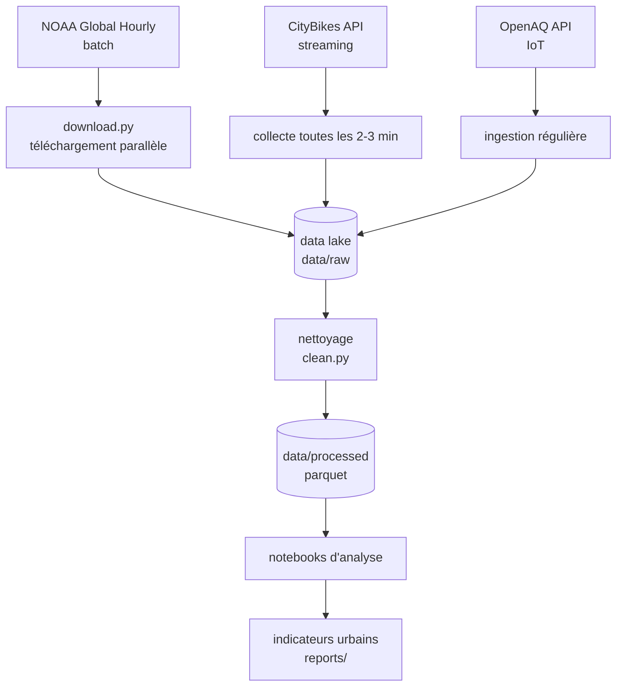

# UrbanHub

jumeau numérique urbain : ingestion et analyse de données smart city (météo, mobilité, pollution) sur les principales villes de france.

projet final mastère big data & ia — ipssi — steven jansen & julien cantau

## architecture



## répartition

| partie | flux | qui |
|---|---|---|
| 1 | batch — météo NOAA | steven |
| 2 | streaming — vélos CityBikes | steven |
| 3 | IoT — pollution OpenAQ | julien |
| 4 | analyse croisée | julien |

## structure

```
urbanhub/
├── src/
│   ├── batch_noaa/          # partie 1
│   │   ├── config.py        # années, stations des grandes villes, chemins
│   │   ├── stations.py      # liste des stations FR (isd-history)
│   │   ├── download.py      # téléchargement parallèle
│   │   └── clean.py         # nettoyage -> parquet
│   └── streaming_citybikes/ # partie 2
├── notebooks/
│   └── 01_partie1_meteo_batch.ipynb
├── tests/
├── data/                    # data lake (non versionné)
│   ├── raw/noaa/year=YYYY/STATION.csv
│   └── processed/noaa/year=YYYY/STATION.parquet
└── reports/                 # figures et résultats
```

## installation

```powershell
python -m venv .venv
.venv\Scripts\activate
pip install -r requirements.txt
```

## partie 1 — météo (batch NOAA)

source : NOAA Global Hourly (ISD), un fichier csv par station et par année. l'adresse d'origine (`ncei.noaa.gov/data/global-hourly/access/`) renvoie maintenant une page html : on télécharge les mêmes fichiers depuis le bucket public NOAA sur AWS (`noaa-global-hourly-pds`).

période : 2021 → 2025. le jeu ISD s'arrête fin août 2025 (NOAA l'a remplacé par GHCNh), donc 2025 est incomplète et 2026 n'existe pas.

```powershell
# 1. liste des stations françaises
python -m src.batch_noaa.stations

# 2. téléchargement parallèle (5 dernières années complètes)
python -m src.batch_noaa.download --cities-only   # rapide : stations des 12 grandes villes
python -m src.batch_noaa.download                 # toutes les stations FR (plusieurs Go)

# 3. nettoyage
python -m src.batch_noaa.clean

# 4. analyse
jupyter notebook notebooks/01_partie1_meteo_batch.ipynb
```

**téléchargement** : la liste des stations vient du référentiel `isd-history.csv` (pays = FR, actives sur la période). les fichiers sont téléchargés en parallèle via un `ThreadPoolExecutor` (16 threads par défaut, `--workers` pour changer) avec une session http partagée et des retry automatiques. les fichiers déjà présents sont ignorés, donc on peut relancer après une coupure. chaque run écrit un journal dans `data/raw/noaa/_logs/`.

**nettoyage** :
- découpage des champs composites NOAA (`WND`, `VIS`, `TMP`, `DEW`, `SLP`, `AA1`)
- valeurs sentinelles (9999, 99999, 999999) → valeurs manquantes
- codes qualité 2, 3, 6, 7 (suspect / erroné) → valeurs manquantes
- conversions d'unités : °C ×10 → °C, m/s ×10 → m/s, hPa ×10 → hPa, m → km, mm ×10 → mm
- vent calme → vitesse 0, sans direction ; vent variable → sans direction
- valeurs hors bornes physiques → valeurs manquantes (ex. température hors [-40, 50] °C)
- pression : la SLP n'est donnée que dans les SYNOP (toutes les 3h) ; pour les METAR horaires on complète avec le QNH (champ MA1), quasi identique
- doublons station/heure (METAR + SYNOP au même instant) fusionnés, priorité au METAR
- timestamp converti en datetime UTC (converti en heure de Paris pour les agrégations journalières)
- pluie reconstruite en cumul journalier, car les stations la déclarent sur 1h, 3h, 6h, 12h ou 24h
- rapport de complétude dans `data/processed/noaa/_quality_report.csv`

variables finales : `station_id`, `timestamp`, `temperature` (°C), `wind_speed` (m/s), `wind_direction` (°), `pressure` (hPa), `precipitation` (mm), `visibility` (km), plus `dew_point`, `station_name`, `city`, `latitude`, `longitude`.

le point de rosée n'était pas demandé mais on le garde : c'est lui qui explique le mieux la visibilité (brouillard).

**questions métier** (notebook) :
1. périodes anormales : écart à une normale saisonnière robuste par station (z-score), + isolation forest multivariable
2. météo vs visibilité : corrélations de spearman, visibilité par classe d'humidité et de pluie, fréquence du brouillard par mois/heure
3. évolution saisonnière : moyennes mensuelles france + grandes villes, cycle saisonnier par ville
4. jours extrêmes : seuils absolus (canicule, grand froid, vent, pluie, brouillard) + seuils relatifs au climat de chaque station

## tests

```powershell
python -m pytest tests -v

# tester tout le pipeline sans réseau sur des données simulées
$env:URBANHUB_DATA_DIR="C:\temp\urbanhub_test"
python -m tests.make_sample_data
python -m src.batch_noaa.clean
```
