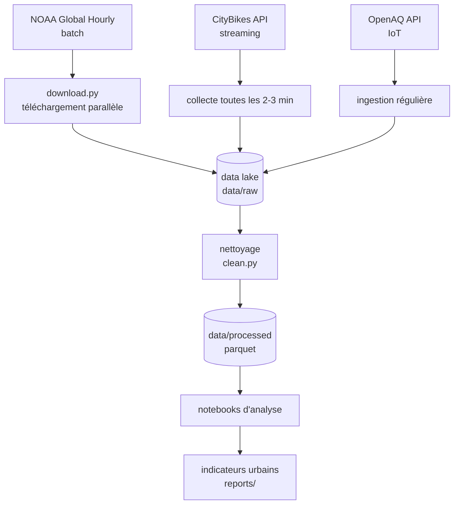

# UrbanHub

jumeau numérique urbain : ingestion et analyse de données smart city (météo, mobilité, pollution) sur les principales villes de france.

projet final mastère big data & ia — ipssi — steven jansen & julien cantau & mohamed elkaddouri

## architecture



## répartition

| partie | flux | qui |
|---|---|---|
| 1 | batch — météo NOAA | steven |
| 2 | streaming — vélos CityBikes | steven |
| 3 | IoT — pollution OpenAQ | contribution intégrée via PR #1 |
| 4 | analyse croisée | julien |

## structure

```
urbanhub/
├── src/
│   ├── batch_noaa/          # partie 1
│   │   ├── config.py        # années, stations des grandes villes, chemins
│   │   ├── stations.py      # liste des stations FR (isd-history)
│   │   ├── download.py      # téléchargement parallèle
│   │   └── clean.py         # nettoyage -> parquet
│   ├── streaming_citybikes/ # partie 2
│   │   ├── config.py        # réseaux des grandes villes, intervalle de collecte
│   │   ├── collector.py     # collecte automatique toutes les 2 min 30
│   │   └── process.py       # snapshots bruts -> parquet
│   ├── iot_openaq/          # partie 3 (PR #1 intégrée)
│   └── analysis_cross/      # partie 4 : préparation, météo, jointures, rapports
├── notebooks/
│   ├── 01_partie1_meteo_batch.ipynb
│   ├── 02_partie2_velos_streaming.ipynb
│   ├── 03_partie3_pollution_iot.ipynb
│   └── 04_partie4_analyse_croisee.ipynb
├── tests/
├── data/                    # data lake (non versionné)
│   ├── raw/noaa/year=YYYY/STATION.csv
│   ├── raw/citybikes/dt=YYYY-MM-DD/RESEAU/HHMMSS.json.gz
│   ├── processed/noaa/year=YYYY/STATION.parquet
│   └── processed/citybikes/dt=YYYY-MM-DD.parquet
└── reports/                 # figures et résultats
```

## installation

```powershell
python -m venv .venv
.venv\Scripts\activate
pip install -r requirements.txt
```

## partie 1 — météo (batch NOAA)

source : NOAA Global Hourly (ISD), un fichier csv par station et par année. l'adresse d'origine (`ncei.noaa.gov/data/global-hourly/access/`) renvoie maintenant une page html : on télécharge les mêmes fichiers depuis le bucket public NOAA sur AWS (`noaa-global-hourly-pds`).

période : 2021 → 2025. le jeu ISD s'arrête fin août 2025 (NOAA l'a remplacé par GHCNh), donc 2025 est incomplète et 2026 n'existe pas.

```powershell
# 1. liste des stations françaises
python -m src.batch_noaa.stations

# 2. téléchargement parallèle (5 dernières années complètes)
python -m src.batch_noaa.download --cities-only   # rapide : stations des 12 grandes villes
python -m src.batch_noaa.download                 # toutes les stations FR (plusieurs Go)

# 3. nettoyage
python -m src.batch_noaa.clean

# 4. analyse
jupyter notebook notebooks/01_partie1_meteo_batch.ipynb
```

**téléchargement** : la liste des stations vient du référentiel `isd-history.csv` (pays = FR, actives sur la période). les fichiers sont téléchargés en parallèle via un `ThreadPoolExecutor` (16 threads par défaut, `--workers` pour changer) avec une session http partagée et des retry automatiques. les fichiers déjà présents sont ignorés, donc on peut relancer après une coupure. chaque run écrit un journal dans `data/raw/noaa/_logs/`.

**nettoyage** :
- découpage des champs composites NOAA (`WND`, `VIS`, `TMP`, `DEW`, `SLP`, `AA1`)
- valeurs sentinelles (9999, 99999, 999999) → valeurs manquantes
- codes qualité 2, 3, 6, 7 (suspect / erroné) → valeurs manquantes
- conversions d'unités : °C ×10 → °C, m/s ×10 → m/s, hPa ×10 → hPa, m → km, mm ×10 → mm
- vent calme → vitesse 0, sans direction ; vent variable → sans direction
- valeurs hors bornes physiques → valeurs manquantes (ex. température hors [-40, 50] °C)
- pression : la SLP n'est donnée que dans les SYNOP (toutes les 3h) ; pour les METAR horaires on complète avec le QNH (champ MA1), quasi identique
- doublons station/heure (METAR + SYNOP au même instant) fusionnés, priorité au METAR
- timestamp converti en datetime UTC (converti en heure de Paris pour les agrégations journalières)
- pluie reconstruite en cumul journalier, car les stations la déclarent sur 1h, 3h, 6h, 12h ou 24h
- rapport de complétude dans `data/processed/noaa/_quality_report.csv`

variables finales : `station_id`, `timestamp`, `temperature` (°C), `wind_speed` (m/s), `wind_direction` (°), `pressure` (hPa), `precipitation` (mm), `visibility` (km), plus `dew_point`, `station_name`, `city`, `latitude`, `longitude`.

le point de rosée n'était pas demandé mais on le garde : c'est lui qui explique le mieux la visibilité (brouillard).

**questions métier** (notebook) :
1. périodes anormales : écart à une normale saisonnière robuste par station (z-score), + isolation forest multivariable
2. météo vs visibilité : corrélations de spearman, visibilité par classe d'humidité et de pluie, fréquence du brouillard par mois/heure
3. évolution saisonnière : moyennes mensuelles france + grandes villes, cycle saisonnier par ville
4. jours extrêmes : seuils absolus (canicule, grand froid, vent, pluie, brouillard) + seuils relatifs au climat de chaque station

## partie 2 — mobilité urbaine (streaming CityBikes)

source : [API CityBikes](https://api.citybik.es/v2/), état en temps réel des stations de vélos en libre-service. 10 réseaux : vélib' (paris), vélo'v (lyon), levélo (marseille), vélô (toulouse), bicloo (nantes), vélhop (strasbourg), vélomagg (montpellier), v³ (bordeaux), v'lille (lille), le vélo star (rennes). nice n'a pas de réseau à stations dans CityBikes (pony est en free-floating). le flux de levélo (marseille) déclare 0 vélo sur toutes ses stations à chaque collecte : il est collecté mais exclu des analyses tant que c'est le cas.

```powershell
# 1. collecte en continu (laisser tourner dans un terminal dédié, Ctrl+C pour arrêter)
python -m src.streaming_citybikes.collector

# 2. traitement des snapshots bruts
python -m src.streaming_citybikes.process

# 3. analyse
jupyter notebook notebooks/02_partie2_velos_streaming.ipynb
```

**collecte** : toutes les 2 min 30, les 10 réseaux sont interrogés en parallèle. la réponse brute est stockée telle quelle (compressée) dans le data lake, partitionnée par jour et par réseau, ce qui permet de rejouer le traitement sans rappeler l'api. seule la liste des identifiants de vélos (`bike_uids`) est retirée, car elle est volumineuse et inutile. un réseau en panne n'arrête pas la collecte. les collectes sont calées sur une grille fixe, donc pas de dérive dans le temps.

limite importante : l'api ne donne que l'état actuel des stations, sans historique. il est impossible de récupérer les données « depuis l'existence du réseau vélib' ». la période d'analyse est la période pendant laquelle le collecteur a tourné.

**traitement** : aplatissement du json, timestamps convertis en utc (l'api renvoie un format non standard `+00:00Z`), stations virtuelles et hors service (ni prêt ni retour possible) écartées, capacité = vélos + places libres, dédoublonnage station/collecte, un parquet par jour.

variables : `station_id`, `station_name`, `latitude`, `longitude`, `timestamp`, `bikes_available`, `free_slots`, plus `collected_at`, `capacity`, `network`, `city`.

**questions métier** (notebook) :
1. taux d'utilisation : rotations par jour (mouvements de vélos / capacité), estimées à partir des variations entre deux collectes
2. offre insuffisante : carroyage ~1 km, zones où les stations sont vides plus de 25 % du temps
3. pics journaliers : activité par heure, semaine vs week-end, vélos en circulation
4. déséquilibres géographiques : remplissage selon la distance au centre et le créneau horaire (mouvement pendulaire), cartes matin/soir
5. stations critiques : vides ou pleines plus de 30 % du temps aux heures de pointe → à réapprovisionner / à délester

## tests

```powershell
python -m pytest tests -v

# tester tout le pipeline sans réseau sur des données simulées
$env:URBANHUB_DATA_DIR="C:\temp\urbanhub_test"
python -m tests.make_sample_data
python -m src.batch_noaa.clean
python -m tests.make_sample_citybikes
python -m src.streaming_citybikes.process
```


## partie 3 — pollution OpenAQ (contribution intégrée)

Le pipeline et le notebook 03 ont été intégrés via la PR #1. Depuis la racine, après configuration de `OPENAQ_API_KEY` dans l'environnement :

```bash
python -m src.iot_openaq.collector
python -m src.iot_openaq.process
python -m src.iot_openaq.history
python -m src.iot_openaq.process
jupyter notebook notebooks/03_partie3_pollution_iot.ipynb
```

Cette version collecte quelques localisations françaises et sept jours d'historique pour un capteur NO₂ parisien ; son nettoyage conserve les 30 derniers jours. Elle ne fournit pas encore l'historique 2021–2025 requis pour un croisement NOAA. Voir les limites détaillées dans [la documentation de la partie 4](docs/partie4_analyse_croisee.md).

## partie 4 — analyse croisée (Julien Cantau)

Code : `src/analysis_cross/`. Notebook : [04_partie4_analyse_croisee.ipynb](notebooks/04_partie4_analyse_croisee.ipynb).

Après les traitements précédents et l'export journalier du notebook 01 :

```bash
# Météo aux dates de collecte vélo (API sans clé, réponses brutes conservées)
python -m src.analysis_cross.weather
# Jointures et rapports, sans appel réseau
python -m src.analysis_cross.run
jupyter notebook notebooks/04_partie4_analyse_croisee.ipynb
```

Les parquets vélo par station sont préférés à l'export horaire 02 : la partie 4 recalcule les stocks moyens et rapporte les mouvements au temps réellement observé. Si seul l'export 02 existe, seule son information de remplissage est exploitée.

Quatre croisements : météo actuelle–vélos, NOAA–pollution journalière, pollution–vélos et intersection des trois flux. Les jointures utilisent uniquement les dates communes ; les polluants et unités restent séparés. Les sorties sont dans `data/processed/cross_analysis/` et `reports/partie4/`.

Sans fichiers réels, le notebook produit un diagnostic de sources absentes ; aucune donnée simulée n'est présentée comme un résultat. Les corrélations sont descriptives et exigent au moins 30 observations sur sept jours. Le croisement NOAA–pollution nécessite un historique OpenAQ absent de la version actuelle.

**Documentation détaillée de la contribution, calculs, commandes et trame de soutenance : [docs/partie4_analyse_croisee.md](docs/partie4_analyse_croisee.md).**
